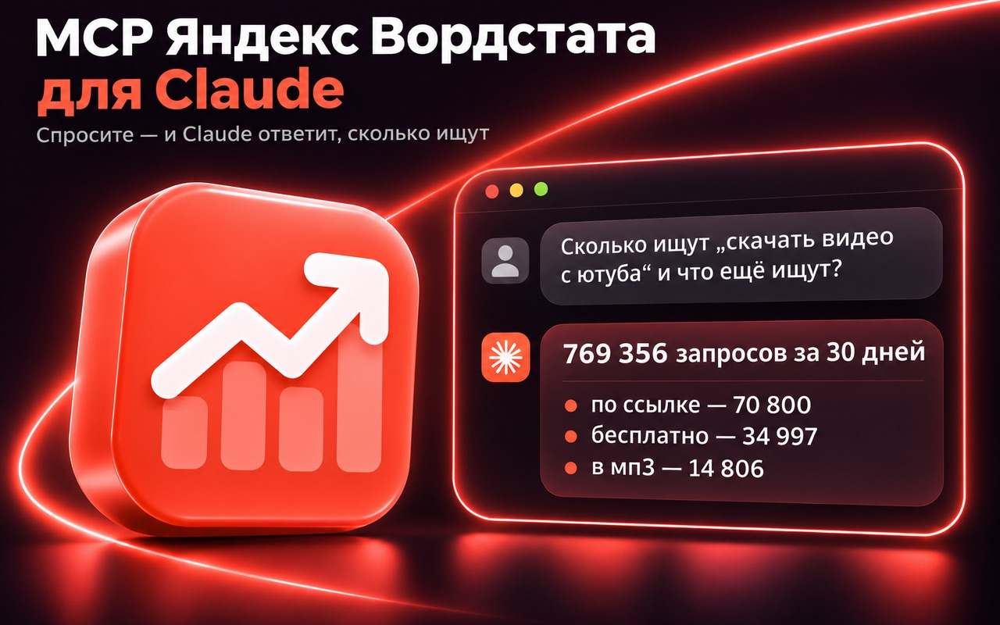
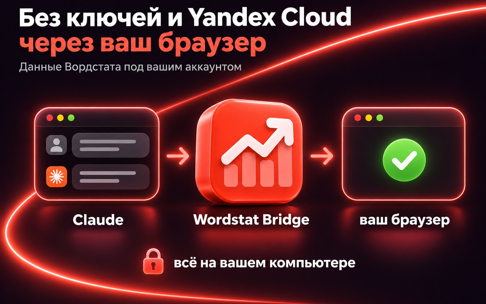
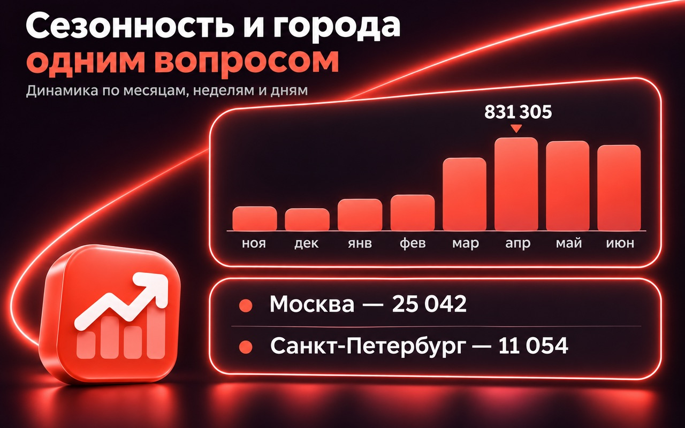

<p align="center">
  
</p>

<h1 align="center">Wordstat Bridge</h1>

<p align="center">
  <b>MCP Яндекс Вордстата для Claude: сколько раз ищут запрос, что ещё ищут, сезонность, города и семантическое ядро.</b><br>
  Как Wordstat API, только без ключей и Yandex Cloud: данные берутся с wordstat.yandex.ru под вашим входом в Яндекс.
</p>

<p align="center">
  <a href="https://chromewebstore.google.com/detail/deohadmdopjheebclbepkpiboiafjieo"><b>Установить из Chrome Web Store</b></a> ·
  <a href="https://github.com/kaicex/wordstat-bridge/releases/latest/download/wordstat-bridge.mcpb"><b>Скачать для Claude Desktop</b></a> ·
  <a href="https://www.npmjs.com/package/wordstat-bridge-mcp">npm</a> ·
  <a href="mailto:kayratdesign@gmail.com">Поддержка</a>
</p>

<p align="center">
  <a href="https://github.com/kaicex/wordstat-bridge/releases/latest"></a>
  <a href="https://www.npmjs.com/package/wordstat-bridge-mcp"></a>
  
</p>

---

## Зачем

Открыть Вордстат, вбить фразу, скопировать таблицу, вставить в Claude. И так двадцать раз. А для
официального API — Yandex Cloud, ключи и оплата запросов.

С Wordstat Bridge вы просто спрашиваете Claude: **«Сколько ищут „купить велосипед“ в Москве и что ещё
ищут рядом?»** Claude сам берёт свежие данные Вордстата и отвечает готовым разбором.

<p align="center">
  
  
</p>

## Что можно спросить

- Сколько раз в месяц ищут фразу и что ищут вместе с ней
- Сколько ищут ровно эту формулировку — для списка до 50 фраз сразу
- Как менялся спрос по месяцам, неделям и дням: когда сезон
- В каких городах и регионах ищут чаще всего
- Собрать семантическое ядро: группы по смыслу, без дублей, с отсевом накрученных фраз и минус-словами

<p align="center">
  
  
</p>

## Установка за 2 минуты

1. **Расширение в браузер** — [Wordstat Bridge в Chrome Web Store](https://chromewebstore.google.com/detail/deohadmdopjheebclbepkpiboiafjieo) (Chrome, Яндекс Браузер и другие на Chromium).
   После установки откроется гид по остальным шагам.
2. **Сервер в Claude:**
   - **Claude Desktop** — скачайте [`wordstat-bridge.mcpb`](https://github.com/kaicex/wordstat-bridge/releases/latest/download/wordstat-bridge.mcpb)
     и откройте двойным кликом.
   - **Claude Code** — одна команда:
     ```
     claude mcp add --scope user wordstat -- npx -y wordstat-bridge-mcp
     ```
3. **Войдите в Яндекс** на wordstat.yandex.ru в том же браузере и спрашивайте Claude.

## Бесплатно и PRO

Бесплатно — 30 запросов к Вордстату и 1 семантическое ядро в день. PRO без лимитов: 490 ₽ в месяц,
1 290 ₽ за 3 месяца, 3 990 ₽ за год. Оформить — в окне расширения.

## Как это работает

```
Claude
  │  MCP
  ▼
сервер Wordstat Bridge — на вашем компьютере
  │
  ▼
расширение в вашем браузере
  │
  ▼
wordstat.yandex.ru — под вашим входом в Яндекс
```

Фразы и ответы Вордстата не уходят на чужие серверы: только между сайтом Вордстата, расширением и
сервером на вашем компьютере.

---

Это репозиторий выпусков: здесь файл для Claude Desktop и история версий. Исходный код закрыт.

Не связан с ООО «Яндекс» и Anthropic, не официальный продукт. Вордстат и Яндекс — товарные знаки
ООО «Яндекс», Claude — товарный знак Anthropic.

© Tentek. Все права защищены.
